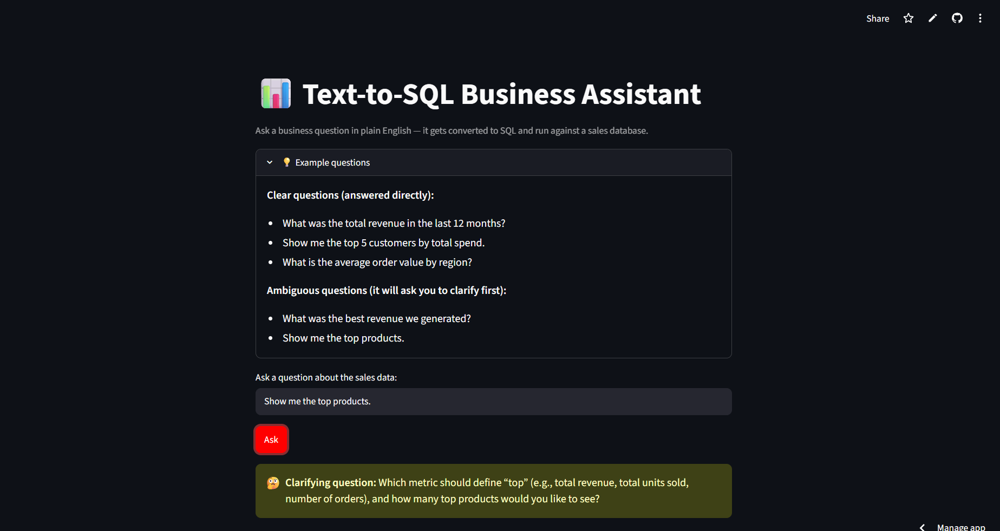
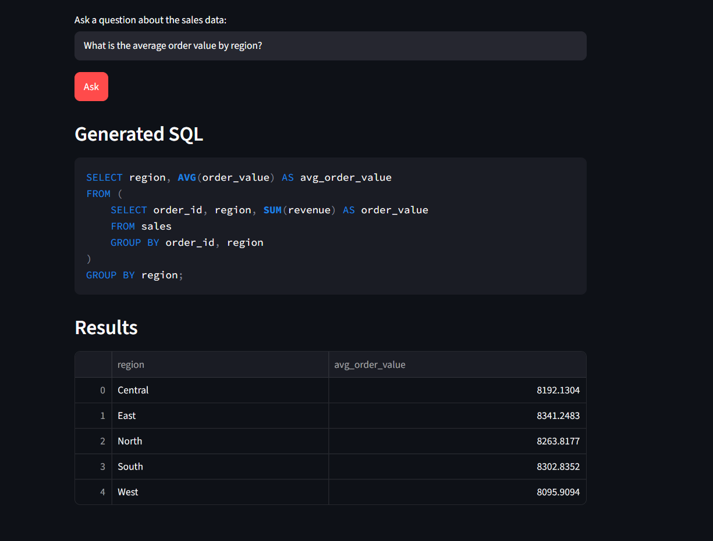

# Text-to-SQL Business Assistant

Live demo link: https://2xzjbzgd8gt8ruhzuccepr.streamlit.app/


Ask a business question in plain English (e.g. *"What was the total revenue in
the last 12 months?"*) and get a real answer — pulled live from a SQL database,
via an LLM that converts your question into a SQL query, runs it, and shows
you both the generated SQL and the results.

## Why this project

Business stakeholders often can't write SQL, but they know what question they
want answered. This tool closes that gap: it lets a non-technical user query a
database in natural language, while staying transparent by always showing the
generated SQL — so results are auditable, not a black box.

## Architecture

```
User question (English)
      |
      v
Groq LLM (LLaMA 3.3 70B) + schema context
      |
      v
Generated SQL query
      |
      v
SQLite execution
      |
      v
Results table (Streamlit UI)
```

- **LLM**: Groq's free-tier API (OpenAI GPT-OSS 120B) — fast, free, no hosting cost.
- **Database**: SQLite — lightweight, no server setup needed for a demo.
- **UI**: Streamlit — quick, clean interface with live SQL + results display.

## Setup

1. Open this folder in VS Code (File → Open Folder), then open a terminal
   inside VS Code (Terminal → New Terminal) — run all commands below there.
2. Install dependencies:
   ```bash
   pip install groq streamlit pandas python-dotenv
   ```
3. Get a free Groq API key at https://console.groq.com
4. Copy `.env.example` to `.env` and paste your key in:
   ```bash
   cp .env.example .env
   # then edit .env and replace the placeholder with your real key
   ```
5. Run the app:
   ```bash
   streamlit run app.py
   ```

## How it works (not NLTK/rule-based)

This uses an **LLM (Groq's OpenAI GPT-OSS 120B)**, not classical NLP libraries like
NLTK. The LLM reads the schema description and the question together, and
generates SQL directly — this is far more flexible than rule-based parsing,
since it generalizes to questions it's never seen an exact pattern for.

## Ambiguity handling

Before generating SQL, the app first asks the LLM whether the question is
answerable as a single unambiguous query. If not (e.g. *"What was the best
revenue?"* — best by what metric? over what time period?), it asks a
clarifying question first instead of guessing, then combines your answer with
the original question to generate the final SQL.

## Screenshots

The deployed interface is centered around a short question-and-answer flow.



*The app provides example questions and asks for clarification when a request
is ambiguous, such as “Show me the top products.”*



*For a clear question, the app displays the generated SQLite query and the
results grouped by region.*

- **Example questions:** The expandable panel shows clear questions that can
      be answered directly and ambiguous questions that trigger clarification.
- **Clarification prompt:** In the shared screenshot, *"Show me the top
      products"* is identified as ambiguous because “top” could mean revenue,
      units sold, or number of orders. The app asks which metric and how many
      products to return instead of silently guessing.
- **Transparent results:** Once the question is clear, the app displays the
      generated SQLite SQL and the resulting table. Single-value results are also
      highlighted as a metric.

## Dataset

`sales.db` is a sales dataset (5,000 rows, ~2 years, 12 products
across 4 categories, 5 regions) real
e-commerce transaction data. Swap in your own dataset by replacing `sales.db`
and updating the `SCHEMA_DESCRIPTION` in `nl_to_sql.py` to match your schema.

## Example questions it can answer

- What was the total revenue in the last 12 months?
- Which product category generates the most revenue?
- Show me the top 5 customers by total spend.
- What is the average order value by region?
- How many orders were placed in each month of 2025?

## Known limitations / next steps

- The clarification flow currently supports one follow-up answer per question;
      more complex questions may need another iteration.
- No SQL injection protection needed here since this runs read-only queries
  against a local demo DB, but a production version would need query
  validation before execution.
- Free-tier Groq API has rate limits — fine for a demo, not for high-volume use.
